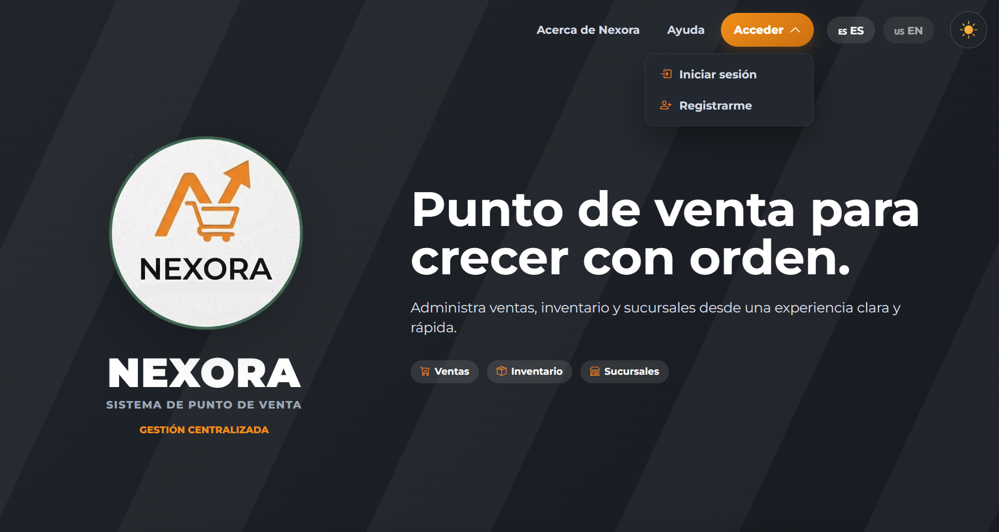
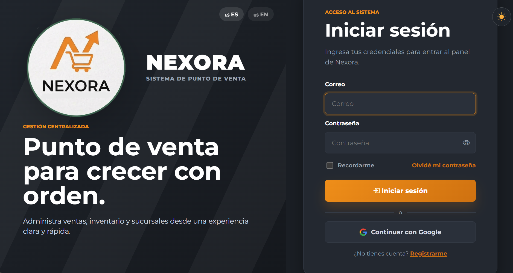
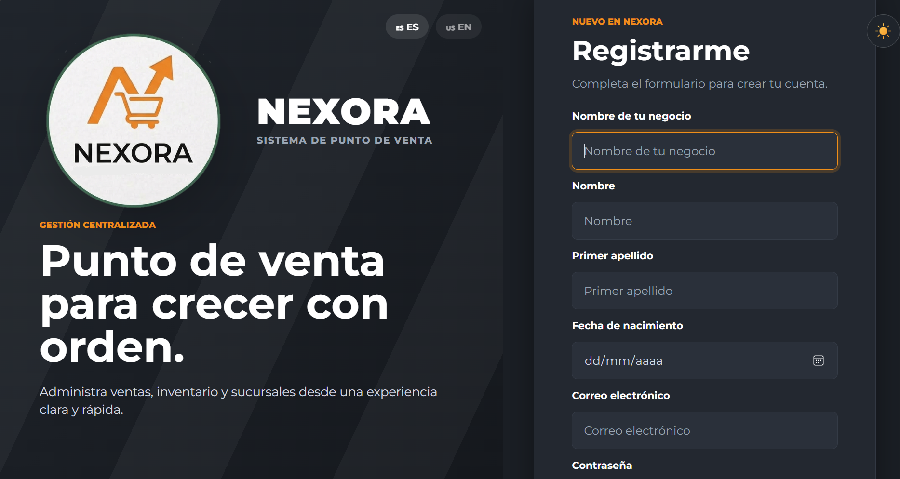
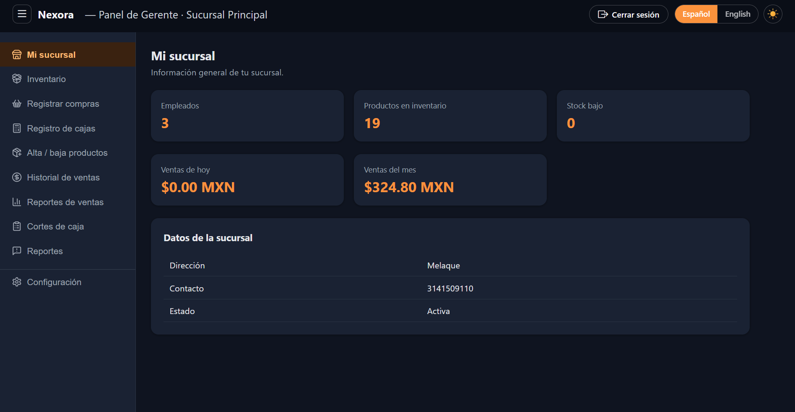
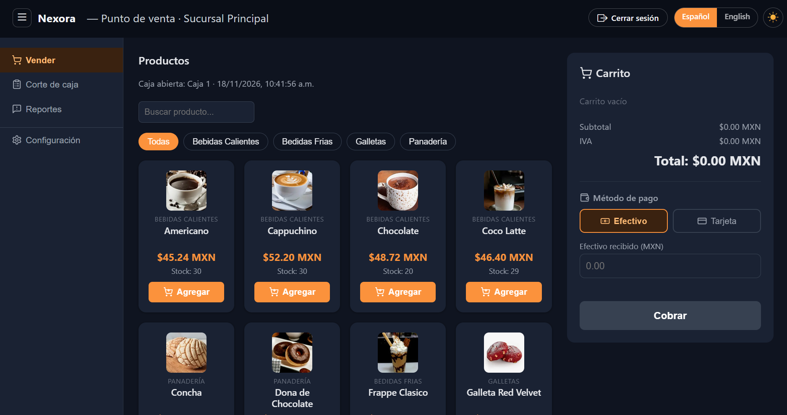

<div align="center">

# 🛒 Nexora

**Sistema de punto de venta multisucursal**

Centraliza ventas, inventario y personal de todas tus sucursales en una sola plataforma.

[](https://github.com/)
[](LICENSE.md)
[](https://www.php.net/)
[](https://developer.mozilla.org/es/docs/Web/HTML)
[](https://developer.mozilla.org/es/docs/Web/CSS)
[](https://laravel.com/)
[](https://developer.mozilla.org/es/docs/Web/JavaScript)
[](https://www.mysql.com/)
[](https://www.postgresql.org/)

</div>

---

## 📖 Descripción

**Nexora** es un sistema de punto de venta (POS) pensado para negocios que operan con más de una sucursal —tiendas de conveniencia, minisúpers, negocios de comida, etc.—. Actualmente, este tipo de negocios suele gestionar sus ventas e inventario de forma independiente en cada sucursal, usando métodos manuales (cuadernos, hojas de cálculo) o sistemas de punto de venta aislados que no se comunican entre sí.

Esta desconexión genera problemas como:

- Falta de visibilidad en tiempo real de ventas e inventario por sucursal.
- Dificultad para tomar decisiones de reabastecimiento (ej. un producto agotado en una sucursal mientras sobra en otra).
- Ausencia de control centralizado de usuarios y roles, permitiendo que cualquier persona con acceso modifique precios o inventario sin un registro claro de quién lo hizo.
- Cortes de caja y control de compras a proveedores hechos manualmente, lo que aumenta el riesgo de errores o pérdidas no detectadas.

**Nexora** busca resolver esto centralizando la operación de todas las sucursales bajo un mismo sistema: cada sucursal mantiene su propio inventario, mientras un administrador central tiene visibilidad y control total sobre sucursales, usuarios, proveedores e inventario.

---

## 🎯 Objetivo general

Desarrollar un sistema de punto de venta (Nexora) que permita centralizar la administración de ventas, inventario, usuarios y proveedores de un negocio con múltiples sucursales, brindando al administrador visibilidad y control en tiempo real sobre la operación de cada punto de venta, y facilitando a cada sucursal la gestión de su propio inventario mediante roles de usuario diferenciados (administrador, gerente, cajero).

---

## 👥 Roles de usuario (planeados)

### 🛡️ Administrador
Control total del sistema: gestión de sucursales, usuarios, proveedores e inventario global.

### 🧑‍💼 Gerente de sucursal
Administra el inventario, ventas y personal de su propia sucursal.

### 🧾 Cajero
Realiza ventas y consulta inventario dentro de su sucursal.

---

## 🛠️ Tecnologías a utilizar

<p align="left">
  
  
  
  
  
  
  
  
  
</p>

| Tecnología | Uso | Capa |
|---|---|---|
| **HTML5** | Estructura de las páginas: login, dashboard, inventario, ventas, etc. | Frontend |
| **CSS3** | Estilo visual: colores, tipografía, distribución y experiencia de usuario. | Frontend |
| **JavaScript** | Interactividad: validación de formularios, actualización dinámica de inventario, alertas de éxito/error. | Frontend |
| **Bootstrap** *(opcional)* | Framework CSS para interfaces responsivas sin diseñar todo desde cero. | Frontend |
| **PHP** | Lógica de negocio, manejo de sesiones y roles (admin, gerente, cajero), conexión con la base de datos. | Backend |
| **SQL** | Gestión de tablas de usuarios, inventarios, ventas y sucursales; consultas, inserciones y actualizaciones. | Datos |
| **MySQL / MariaDB** | Almacenamiento de toda la información del sistema. | Datos |
| **Git + GitHub** | Control de versiones y trabajo colaborativo en equipo. | Colaboración |

### Síntesis por capas

- **Frontend** → HTML, CSS, JavaScript, Bootstrap.
- **Backend** → PHP.
- **Datos** → SQL, gestor de base de datos.
- **Colaboración** → Git / GitHub.

---

## 📁 Estructura del proyecto

```
Nexora/
├── assets/
│   ├── css/
│   ├── js/
│   └── img/
├── config/
│   └── db.php
├── database/
│   └── nexora.sql
├── pages/
│   ├── login.php
│   ├── dashboard.php
│   ├── inventario.php
│   ├── ventas.php
│   ├── sucursales.php
│   └── proveedores.php
├── .gitignore
├── LICENSE.md
└── README.md
```

## 🚧 Estado actual

Nexora se encuentra **finalizado y funcional**. El sistema cuenta con una página de bienvenida, acceso y registro de usuarios con aceptación de términos y aviso de privacidad, paneles diferenciados por rol y un punto de venta listo para operar. Toda la interfaz está disponible en **español e inglés** y en **modo claro y oscuro**.

### 🏠 Página de bienvenida
Es lo primero que ve el usuario: presenta Nexora y ofrece accesos rápidos a *Acerca de Nexora*, *Ayuda* y un menú *Acceder* para iniciar sesión o registrarse.



### 🔐 Inicio de sesión
Acceso al sistema con correo y contraseña, opción de recordar sesión, recuperación de contraseña y acceso con Google.



### 📝 Registro
Formulario para crear una cuenta nueva con los datos del negocio y del usuario. Para registrarse es necesario aceptar los términos y condiciones y el aviso de privacidad.



### 📊 Panel de gerente
Vista general de la sucursal con empleados, productos en inventario, alertas de stock bajo y ventas del día y del mes. Desde el menú lateral se gestionan el inventario, las compras, el registro y corte de cajas, el alta y baja de productos, el historial de ventas y los reportes.



### 🧾 Punto de venta
Pantalla de caja para vender: catálogo de productos con filtro por categoría y búsqueda, carrito con subtotal, IVA y total, y cobro en efectivo o con tarjeta. También permite realizar el corte de caja y consultar reportes.



---

## ✒️ Integrantes del equipo
| Nombre | GitHub |
|---|---|
| Kayleen Avendano Reguera | [@kayleen2807](https://github.com/kayleen2807) |
| Josue Felipe Cruz Espinosa | [@jcruz31-hue](https://github.com/jcruz31-hue) |
| Abril Azucena Diaz Ruelas | [@adiaz108](https://github.com/adiaz108) |
| Carolina Molina Pimentel | [@Carolina234184](https://github.com/Carolina234184) |
| Maximiliano Tejeda Figueroa | [@mtejeda4](https://github.com/mtejeda4) |
---

## 📄 Licencia

Este proyecto está bajo la Licencia [MIT](LICENSE.md). Puedes usarlo, modificarlo y distribuirlo libremente con atribución.

---

<div align="center">

</div>
